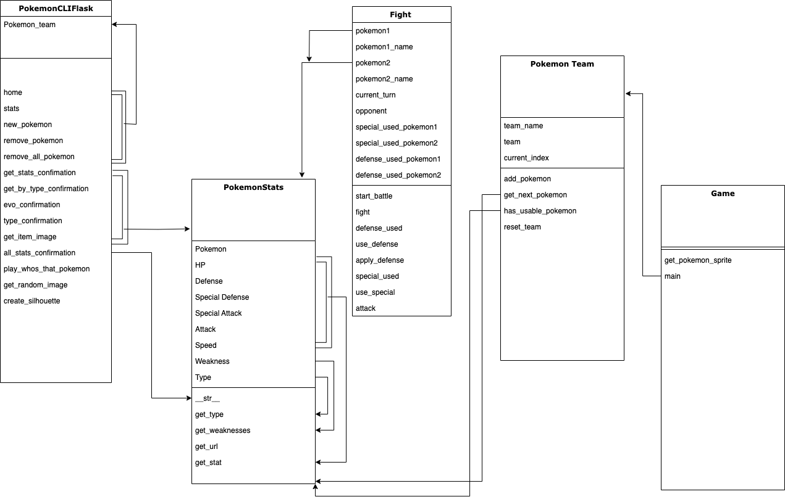

#  PokemonGame

A **Flask web app** and **Pygame battle game** built on live data from [PokéAPI](https://pokeapi.co/). Look up Pokémon, build a team, then fight with it in a small graphical game.


## Features

- **Flask app (localhost):** enter Pokémon names to get stats, types, species info and items. Sprites are fetched and rendered with PIL.
- **Pygame battle game:** move your Pokémon around the map, then go into a turn-based fight.
- **Live data:** all stats come from PokéAPI over REST, so nothing is hard-coded.
- **Tested OOP core:** game logic sits in separate classes with `unittest` coverage.

## Architecture

| Class | Responsibility |
|---|---|
| `Pokemon` | Fetches and stores one Pokémon's stats from PokéAPI |
| `PokemonTeam` | Manages a group of Pokémon |
| `Fight_pok` | Runs battle logic and returns the updated Pokémon objects |
| `Game` | The Pygame loop: rendering, movement, starting fights |



## Project layout

```
Classes/   core game logic (Pokemon, Team, Fight, Game)
CLI/       Flask app and command-line interface
Tests/     unittest suites with JSON fixtures
Images/    game backgrounds
```

## Running it

```bash
git clone https://github.com/akutsner/PokemonGame.git
cd PokemonGame
pip install flask pygame pillow requests

# Web app
python -m CLI.PokemonCLIFlask      # then open http://127.0.0.1:5000

# Battle game
(cd Classes && PYTHONPATH=.. python Game.py)

# Tests
(cd Tests && PYTHONPATH=.. python -m unittest discover -p "*.py")
```

## Docs

- [Project plan](https://docs.google.com/document/d/13xyrmpg3eouMlViaDbp38LCjB5lxi-1LLU55QSppQFw/edit?tab=t.0)
- [Design doc](https://docs.google.com/document/d/1oLTIwncixCq4fjC3jh93bzZysGgFBU1P1QhiqEDQgo0/edit?usp=sharing)
